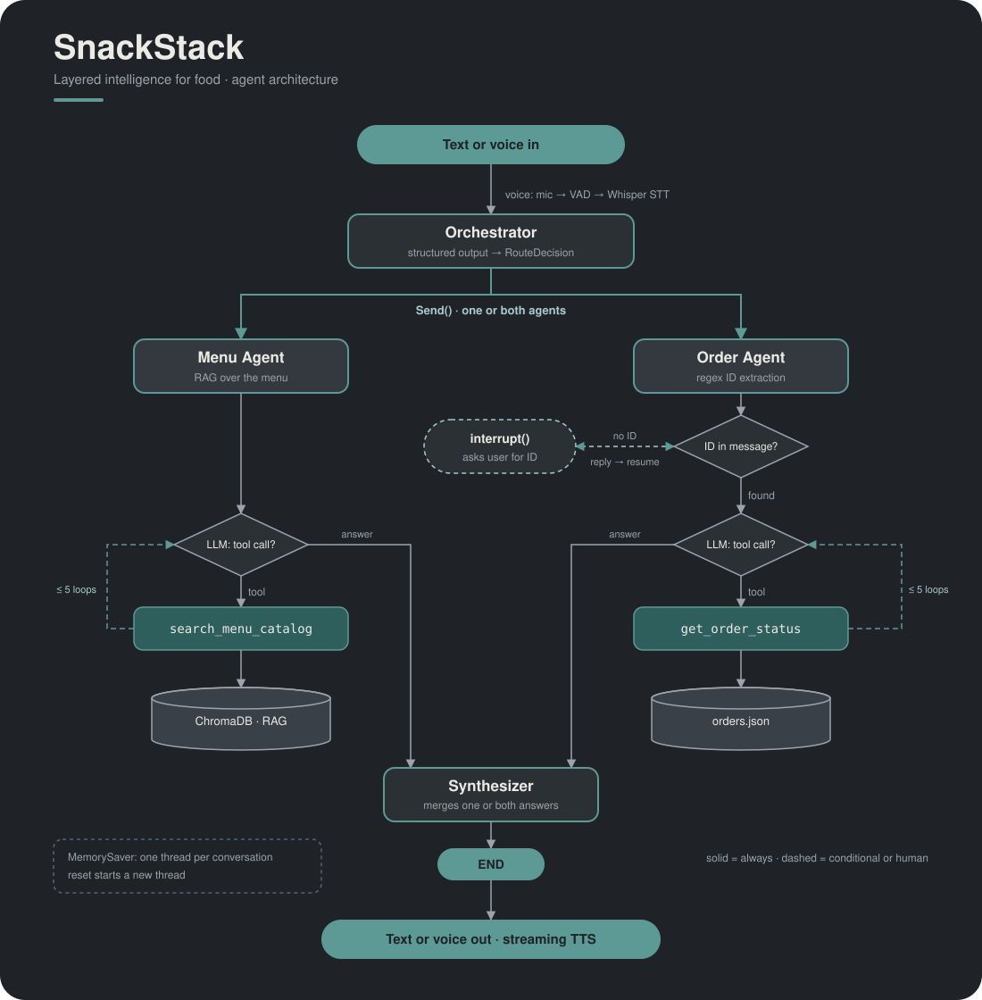

# SnackStack

A voice-enabled, multi-agent food delivery assistant built with **LangGraph**. You can ask about the menu, track an order, or both in one sentence, by typing or by talking.



## How it works

```
text / mic (VAD -> Whisper STT)
        |
   orchestrator      structured-output routing (Pydantic)
        |  Send()    parallel fan-out
   +----+-----+
 menu_agent  order_agent     each runs its own tool-calling loop
 (RAG over   (regex ID extraction,
  ChromaDB)   interrupt() asks for a missing ID)
   +----+-----+
        |
   synthesizer       merges one or both answers
        |
text / speaker (streaming TTS)
```

- **Orchestrator** decides which agent(s) handle the message. Greetings and unclear messages go to the menu agent.
- **Menu agent** searches an in-memory ChromaDB store of the menu using `text-embedding-3-small`.
- **Order agent** looks up orders by order ID (`ORD-201`), tracking ID (`SS201TRK`), or email. If none is given, the graph pauses (human-in-the-loop) and asks for one.
- **Memory** comes from `MemorySaver`: each conversation is a thread, and `reset` starts a new one.
- **Voice** is framework-free: energy-based VAD, batch STT, and streaming PCM TTS, with text normalization so prices and IDs sound right when spoken.

## Setup

Needs Python 3.12, [uv](https://docs.astral.sh/uv/), and an OpenAI API key.

```bash
uv sync
cp .env.example .env      # then put your OPENAI_API_KEY in .env (it is gitignored)
```

## Run

```bash
uv run snackstack              # text in, text out
uv run snackstack --voice-out  # text in, spoken replies
uv run snackstack --voice      # speak and listen (headphones recommended)
```

Try: `hi` · `Show me vegan dishes` · `Track order ORD-201` · `Where is my order?` · `Pizza options and track ORD-203` · `reset` · `quit`

Test the voice pieces one at a time:

```bash
uv run snackstack-voice tts-stream   # speaker check
uv run snackstack-voice vad          # record until you stop talking -> recording.wav
uv run snackstack-voice stt          # transcribe recording.wav
```

Tuning: `--threshold 0.01` for a quiet mic, `0.05` for a noisy room; `--silence-ms 1200` if it cuts you off.

## Tests

```bash
uv run pytest   # offline: order tools, VAD, WAV encoding, speech normalization
```

## Project layout

```
src/snackstack/
  config.py  state.py  graph.py  main.py  voice.py  logger.py
  agents/   orchestrator, menu_agent, order_agent, synthesizer, prompts, shared tool loop
  tools/    rag.py (ChromaDB), menu_tools.py, order_tools.py
  data/     menu.json (8 dishes), orders.json (5 orders)
tests/
```

The menu and orders are fictional sample data.
